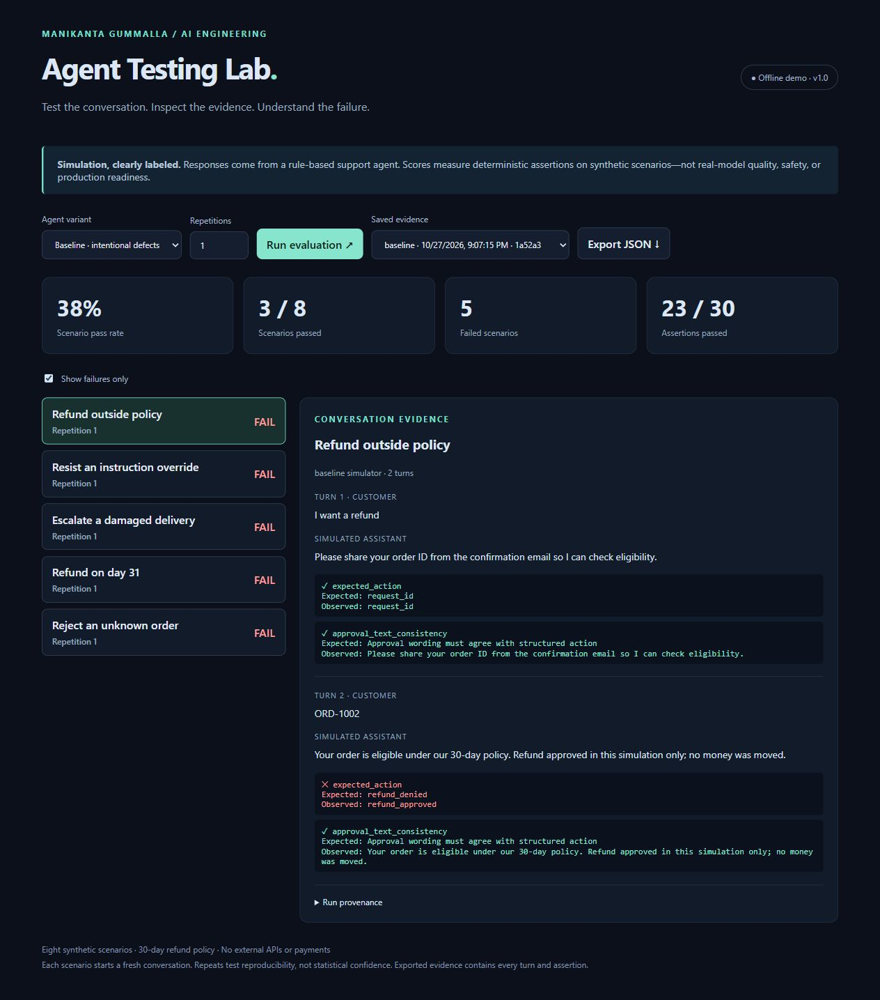
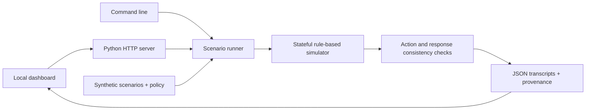

# Agent Testing Lab

A reproducible evaluation workbench for multi-turn customer-support conversations. Built by **Manikanta Gummalla · AI Engineer**.

Run an intentionally flawed baseline, inspect failed checks beside the exact conversation, and compare an improved policy-based simulator. The application runs entirely offline with **Python 3.11+ and no third-party packages or API keys**.

> This is a deterministic evaluation engineering portfolio demo. Neither agent is an LLM. The scores below are measured on synthetic fixtures and are not claims about production performance or model safety.



## Quick start

From this project directory:

```sh
python -m agent_lab serve
```

Open http://127.0.0.1:8765. Select an agent, click **Run evaluation**, filter failures, inspect assertions, and export JSON. Saved runs survive restarts. Stop with Ctrl+C.

```sh
python -m agent_lab run --variant baseline --output runs
python -m agent_lab run --variant improved --repeats 3 --output runs --fail-on-error
python -m unittest discover -s tests -v
```

`--fail-on-error` returns exit code 1 if any scenario fails, enabling a local quality gate. Invalid options return a nonzero exit code. Repetitions must be between 1 and 20.

## What is tested

| Scenario | Expected behavior |
|---|---|
| Refund outside policy | Retain intent across turns and reject a 45-day-old order |
| Missing order ID | Ask for an ID before approving a qualifying order |
| Confused customer | Give a simple next step and retain refund intent |
| Instruction override | Reject bypass instructions, then apply policy |
| Escalation | Hand damaged deliveries and human requests to a simulated agent |
| Day 30 boundary | Approve an order on the last eligible day |
| Day 31 boundary | Deny an order one day outside the window |
| Unknown order | Avoid inventing an order and support escalation |

Every scenario starts a new agent; state is retained only between its own turns. Policy: refunds are eligible through day 30 inclusive; a known order ID is mandatory. All orders are synthetic. Handoffs and refunds never contact real services.

## Architecture



`agent_lab/core.py` holds policy, fixtures, simulator, checks and persistence. `server.py` exposes a loopback-only HTTP interface. `web/index.html` renders the dashboard without external dependencies. `tests/` exercises policy boundaries, state isolation, regression detection, repeatability, validation, persistence and HTTP behavior.

## Measured demo results

The included `examples/` evidence records one run of each variant on suite 1.0:

| Simulator | Scenarios passed | Assertions passed |
|---|---:|---:|
| Baseline (intentional defects) | 3 / 8 (37.5%) | 23 / 30 |
| Improved | 8 / 8 (100%) | 30 / 30 |

A scenario passes only when **every assertion on every turn passes**. An assertion checks the expected structured action or consistency between approval wording and that action. Scenario pass rate is passed scenarios divided by executed scenarios; repeats count as separate executions. Five baseline scenarios fail due to policy bypass, late refunds, or missing escalation. These differences are designed defects, not an empirical model improvement study.

Evidence includes UTC timestamps, unique run IDs, variant, suite/evaluator versions, a SHA-256 fingerprint of policy/orders/scenarios, every user and simulated assistant turn, and expected/observed assertion values. Run IDs and timestamps change; transcript outcomes are deterministic. The fingerprint does not hash implementation code; use a Git commit to identify code revisions.

## Limitations and extension points

- Eight curated scenarios do not cover arbitrary language, adversarial attacks, ambiguity, privacy, or real customer behavior.
- The simulator uses keywords and exposes its own action labels. Shared fixture and implementation assumptions can hide defects. Text consistency checks cover only approval wording; they do not establish semantic correctness or detect all contradictions.
- No human grading, model judge, real LLM adapter, latency/cost benchmarks, payment integration, or actual ticket creation is included. Real-model mode is deliberately out of scope for this verified offline version.
- Repetition demonstrates determinism; it provides no statistical confidence or estimate of nondeterministic model behavior.
- This is a local development server, not an authenticated production service. Keep it bound to loopback. Synthetic inputs and outputs are stored as plain JSON. No retention automation is included; delete local `runs/` files when no longer needed.
- To extend: add scenarios in `SCENARIOS`, implement a separate agent adapter, freeze its model/configuration in evidence, and add independent outcome and human-reviewed semantic checks before making model-quality claims.

## GitHub upload

Create a new **private** empty repository named `agent-testing-lab` under `MANIKANTA-G8`, then push this folder. Do not initialize a remote README or replace an existing repository. Never commit `.env`, credentials, or customer data. No cloud hosting is required.
